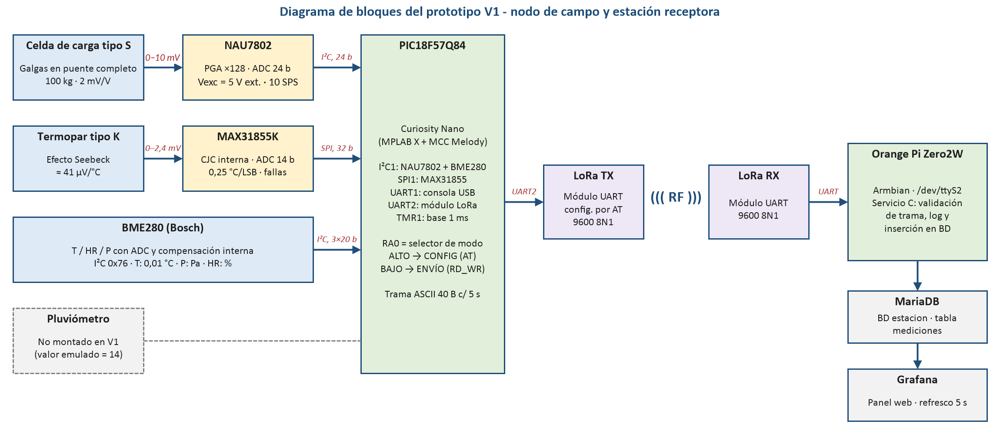

# Lisímetro electrónico de pesada con telemetría LoRa
 
Prototipo de un lisímetro de pesada de bajo costo para estimar la evapotranspiración (ET) de un cultivo a partir de la variación de masa del sistema suelo‑planta, con transmisión inalámbrica de los datos a una estación receptora.
 
## Datos académicos
 
| | |
|---|---|
| **Universidad** | Universidad Nacional de Piura (UNP) |
| **Facultad** | Facultad de Ciencias |
| **Carrera** | Ingeniería Electrónica y Telecomunicaciones |
| **Curso** | Instrumentación Industrial |
| **Docente** | Mg. Yonathan Aguirre Carmen |
| **Año** | 2026 |
 
### Integrantes
 
- Razuri Vegas, Jorge André
- Urbina Arévalo, Vitaly Paolo
- Vilchez Yacila, Gabriela Alessandra
## ¿Qué hace el proyecto?
 
El sistema mide de forma continua la **masa** de un recipiente con suelo y planta mediante una celda de carga tipo S. Como la pérdida de agua del conjunto se refleja directamente en una disminución de masa, la variación de peso permite calcular la ET en milímetros de lámina de agua:
 
```
ET [mm] = Δm [kg] / (ρw [kg/m³] · A [m²]) · 1000
```
 
Además del peso, el nodo registra variables ambientales (temperatura, humedad relativa y presión atmosférica) y la temperatura de la celda, que influye en su cero. Los datos viajan por radio LoRa (433 MHz) hasta una estación receptora, donde se validan, se almacenan en una base de datos y se visualizan en un panel web.
 
## ¿Qué se espera obtener?
 
Una herramienta accesible para que ingenieros agrónomos y gestores de riego conozcan cuánta agua consume realmente un cultivo, y así programar el riego con mayor precisión. Se contrasta con los lisímetros comerciales, cuyo costo es muy alto.
 
Especificaciones objetivo para la masa:
 
| Parámetro | Objetivo |
|---|---|
| Rango | 0 a 100 kg |
| Resolución | ≤ 10 g |
| Exactitud | ± 10 g |
| Repetibilidad | ± 5 g |
| Linealidad | ≤ 0,05 % F.S. |
| Sensibilidad de la celda | 2,0 mV/V |
 
## Arquitectura
 

 
## Hardware
 
| Componente | Función |
|---|---|
| Celda de carga tipo S de 100 kg, 2 mV/V | Transductor de masa (tracción) |
| NAU7802 | Acondicionamiento y ADC de 24 bits; alimentado a 5 V, que también excita la celda |
| Termopar tipo K + MAX31855K | Temperatura de la celda, con compensación de unión fría |
| BME280 | Temperatura, humedad relativa y presión |
| PIC18F57Q84 Curiosity Nano | Adquisición, promedio y armado de la trama |
| 2 × LoRa DX-LR03 (433 MHz) | Enlace inalámbrico por UART |
| Orange Pi Zero2W | Estación receptora |
 
### Pines del microcontrolador
 
| Función | Pines |
|---|---|
| I²C1 (NAU7802 y BME280) | RB1 (SCL1), RB2 (SDA1) |
| SPI1 (MAX31855K) | RC6 (SCK1), RC4 (SDI1), RD4 (CS) |
| UART1 (consola USB) | RF0 (TX1), RF1 (RX1) |
| UART2 (módulo LoRa) | RB0 (TX2), RB3 (RX2) |
| Selector de modo (CONFIG / ENVÍO) | RA0 |
| LED indicador | RF3 |
 
## Software
 
- **Nodo de campo:** firmware en C para PIC18, desarrollado en MPLAB X IDE con el compilador XC8 y MPLAB Code Configurator (MCC Melody). Lee los tres sensores, promedia las muestras y envía una trama ASCII cada 5 s. El pin RA0 elige entre el modo CONFIG (configuración de los módulos LoRa con comandos AT) y el modo ENVÍO.
- **Estación receptora:** servicio en C sobre Armbian que valida la trama, la guarda en MariaDB y la deja disponible para el panel de Grafana, con refresco de 5 s.
## Estructura del repositorio
 
```
.
├── MPLAB_CODE/          Firmware del nodo (proyecto MPLAB X)
│   └── LIBRARY/         Librerías: BME280_I2C, max31855, nau7802, lora_uart y reloj
├── receptor/            Código del receptor (LR03_V1_1.c) para la Orange Pi
├── docs/                Informe del Entregable 2
├── README.md
└── .gitignore
```
 
## Estado del proyecto (versión V1)
 
- La cadena completa funciona de extremo a extremo: sensores → PIC → LoRa → Orange Pi → MariaDB → Grafana.
- Se verificó la coherencia entre temperatura, humedad y presión.
- La celda de carga se observó en reposo (offset y ruido). **Aún no se realizó la calibración formal**, por lo que no se afirma trazabilidad ni exactitud demostrada.
- El pluviómetro no está integrado: el campo de la trama lleva un valor fijo emulado.
### Trabajo siguiente (V2)
 
- Calibración de la celda con masas de referencia (tara, span y barrido).
- Montaje mecánico definitivo con suspensión por rótulas.
- Trama con signo, CRC y banderas de estado por sensor.
- Integración del pluviómetro de balancín.
- PCB, caja protegida y pruebas de alcance LoRa en campo.
## Seguridad
 
La contraseña de la base de datos no debe escribirse en el código ni subirse al repositorio. El receptor debe leerla desde una variable de entorno (`LORA_DB_CLAVE`) o desde un archivo con permisos restringidos, que está excluido en el `.gitignore`.
 
## Documentación
 

# ===== Documentos temporales de Office =====
~$*
.~lock.*
